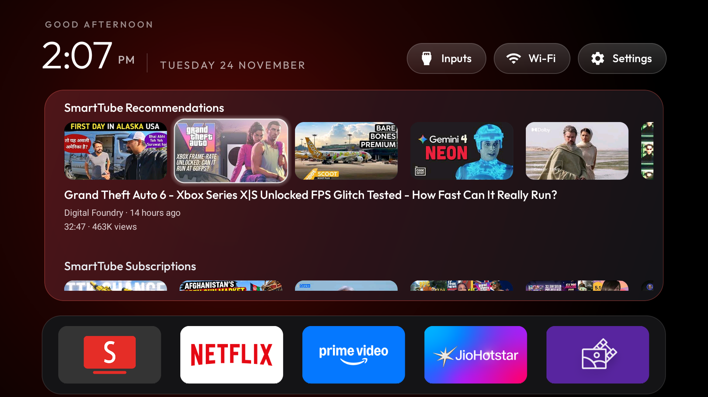
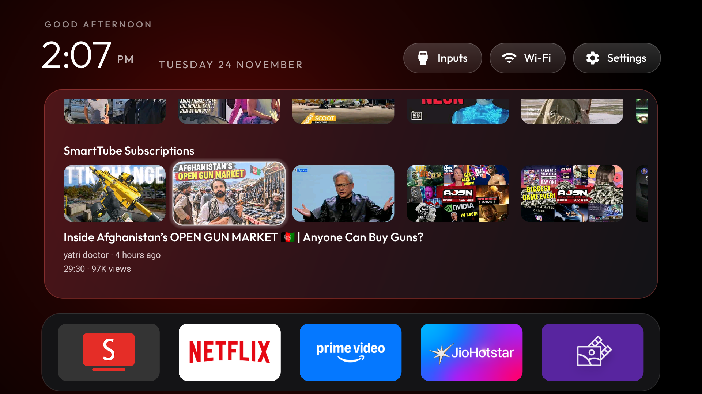

# CleanYourTV SmartTube Shelves

A personal fork of CleanYourTV Home for Android TV. It adds three SmartTube shelves above the app dock and keeps the dock in view while you browse.

## What’s on Home

- **Continue Watching** combines eligible SmartTube Watch Next entries with videos you save on the TV.
- **Recommendations** and **Subscriptions** show the feeds SmartTube publishes to the Android TV provider.
- **Left and Right** browse a shelf. The focused card settles into the second slot when there’s room to scroll, and its details stay aligned with the left edge of the shelf.
- **Up and Down** move between shelves. Focus goes to the nearest visible card in the next shelf.
- **OK** opens the video in SmartTube. **Hold OK** to add or remove it from the local Continue Watching list.

## Screenshots

**Recommendations** on the Hisense TV, with focus on video seven.

**Subscriptions** after one Down press from the Recommendations screenshot.

## Requirements and data

The launcher targets Android TV 8.0 and later. The current shelves use the SmartTube Stable package and depend on the rows it publishes. Android’s TV listings permission lets the launcher read those rows. Thumbnail requests use HTTPS.

Saved videos and hidden entries are stored in the launcher’s private preferences on the TV. SmartTube handles sign-in and feed refresh. Saving a video here leaves the SmartTube account’s Watch Later list and history alone.

## Build and recovery

The screenshots show the layout verified on a Hisense HiSmartTV A4 running Android TV 9. The cleanup revision in this repository passed 350 release unit tests and assembled successfully. Release lint reported zero errors and 98 warnings. The cleanup revision was verified locally.

The launcher build uses JDK 17, Android SDK Platform 34, and Build Tools 34.0.0. From the `launcher/` directory of this repository, run:

~~~powershell
.\gradlew.bat --no-daemon testReleaseUnitTest lintRelease assembleRelease
~~~

For an in-place update, the APK needs the same signer as the installed launcher. Verify the installed APK hash and the default Home resolver after an update. Keep the previous signed APK for layout rollback.

See [FORK.md](FORK.md) for the permission and data details.

## Credits

Based on [CleanYourTV](https://github.com/Gathin23/cleanyourtv). The shelf artwork loader was adapted from [Mehdi-Ks’s `my-tv` branch](https://github.com/Mehdi-Ks/cleanyourtv/tree/my-tv), which credits bjrb20’s shelf work. [SmartTube](https://github.com/yuliskov/SmartTube) provides playback and publishes the feeds.
